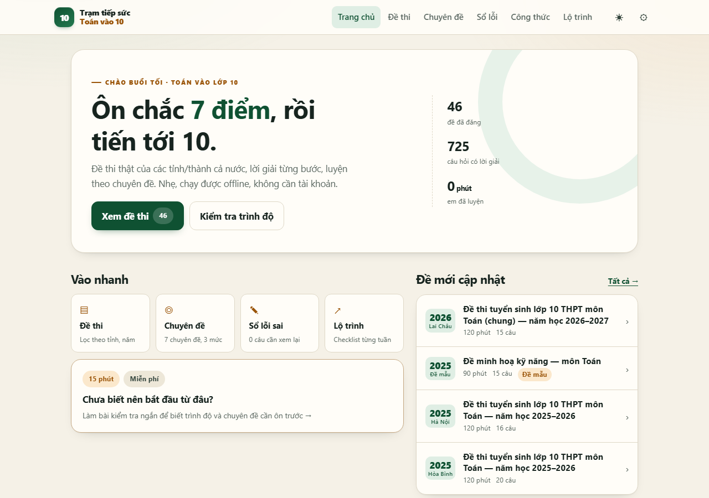

# Trạm tiếp sức Toán vào 10

**Ôn chắc 7 điểm, rồi tiến tới 10.**

Web ôn thi tuyển sinh lớp 10 môn Toán dành cho học sinh cả nước: đề thi thật, lời giải từng bước, luyện theo chuyên đề và chạy được offline sau lần truy cập đầu. Miễn phí, không cần tài khoản, tối ưu cho điện thoại.

[**Dùng thử ngay →**](https://cuong-bo.github.io/toanvao10/) · [Mã nguồn trên GitHub](https://github.com/cuong-bo/toanvao10)



## Sản phẩm này dành cho ai?

- Học sinh lớp 9 đang ôn thi vào lớp 10, đặc biệt các bạn ở vùng còn khó khăn về điều kiện học tập.
- Học sinh muốn tự kiểm tra trình độ, biết mình đang yếu phần nào và có lộ trình ôn tập rõ ràng.
- Giáo viên, phụ huynh cần một nguồn đề chính thức kèm lời giải tham khảo để hướng dẫn học sinh.

## Điểm nổi bật

- **Đề thi thật, ghi rõ nguồn**: tập trung vào đề chính thức của các Sở GD&ĐT, không bịa đề.
- **Lời giải từng bước**: mỗi câu có gợi ý và lời giải chi tiết để học sinh tự đối chiếu.
- **Làm bài như thi thật**: đồng hồ bấm giờ, nộp bài, chấm điểm, xem lại câu đúng/sai.
- **Sổ lỗi thông minh**: tự lưu các câu sai hoặc chưa chắc để ôn lại.
- **Luyện theo chuyên đề**: rút gọn, phương trình, hàm số, Vi-ét, giải toán, hình học, bất đẳng thức.
- **Công thức và lộ trình**: tờ công thức cần nhớ, checklist ôn tập theo tuần.
- **Kiểm tra đầu vào**: biết trình độ hiện tại để chọn đúng phần cần ôn trước.
- **Dùng được offline**: sau lần truy cập đầu, web có thể mở khi mất mạng; hỗ trợ cài lên màn hình chính như ứng dụng.
- **Nhẹ, không phụ thuộc máy chủ**: web tĩnh, không framework, không bước build.

## Dữ liệu hiện có

- **45 đề thật** của **30 tỉnh/thành**.
- **1 đề mẫu** để thử web, ghi rõ không phải đề thi thật.
- **725 câu/ý**, có gợi ý và lời giải từng bước.
- Một số câu hình học nâng cao dùng bổ đề quen thuộc hoặc phương pháp tọa độ.

<details>
<summary><b>Xem 30 tỉnh/thành đã có đề</b></summary>

Điện Biên, Hòa Bình, Lai Châu, Lào Cai, Sơn La, Yên Bái, Hà Nội, Nam Định, Bắc Ninh, Hải Dương, Hải Phòng, Nghệ An, Thanh Hóa, Vĩnh Phúc, Thái Bình, TP. Hồ Chí Minh, Đà Nẵng, Cần Thơ, Quảng Ninh, Thừa Thiên Huế, Hà Tĩnh, Quảng Bình, Quảng Trị, Quảng Nam, Quảng Ngãi, Bình Định, Phú Yên, Khánh Hòa, Lâm Đồng, Đồng Nai.

</details>

Nguồn từng đề, năm thi và mức độ đối chiếu đáp án được ghi tại [`docs/NGUON_DE.md`](docs/NGUON_DE.md).

## Công nghệ

- HTML, CSS và JavaScript thuần; không cần cài đặt hay build.
- KaTeX để hiển thị công thức Toán.
- Hash routing để chạy tốt trên GitHub Pages và hosting tĩnh.
- Service worker + manifest để hỗ trợ PWA/offline.
- Dữ liệu đề dạng JSON, dễ kiểm tra và mở rộng.

## Chạy trên máy

```bash
node tools/serve.js
# mở http://localhost:4173
```

Máy chủ thử phục vụ thư mục `site/`, đồng thời mở API đọc đề nháp trong `drafts/` để giáo viên xem trước.

## Kiểm tra chất lượng

```bash
node tools/validate.js          # kiểm tra cấu trúc đề đã đăng
node tools/validate.js --drafts # kiểm tra bản nháp
node tools/validate.js --all
node tools/audit.js             # kiểm tra điểm, id, đáp án số, lời giải, nguồn
```

Đã kiểm thử bằng Playwright (Chromium) trên điện thoại 390×844 và desktop 1280×900:

- 46 trang đề mở thành công, không lỗi console;
- **725/725 câu không tràn ngang ở màn hình 360px**;
- làm bài, chấm đáp án số/trắc nghiệm/tự luận, nộp bài, kết quả, sổ lỗi;
- luyện chuyên đề, kiểm tra đầu vào, lưu/khôi phục tiến độ, in đề;
- PWA offline và ảnh hình vẽ.

Kết quả Lighthouse mobile gần nhất: **Hiệu năng 91 · Accessibility 100 · Best Practices 100 · SEO 100**.

## Cấu trúc repo

```text
site/                 phần web được đăng
  index.html
  css/ js/ vendor/ icons/
  data/               catalog, chuyên đề, công thức, lộ trình, đề
  images/             hình vẽ theo mã đề
drafts/               bản nháp, không đăng
tools/                serve, validate, publish, build-catalog
docs/                 kế hoạch, nguồn đề, hướng dẫn đăng
.github/workflows/    tự động deploy GitHub Pages
```

## Đăng lên GitHub Pages

Workflow có sẵn tại `.github/workflows/pages.yml`. Mỗi lần push lên `main`, GitHub Actions sẽ tự đăng thư mục `site/`.

Lần đầu cần bật thủ công:

1. Vào **Settings → Pages**.
2. Mục **Build and deployment → Source**, chọn **GitHub Actions**.
3. Vào tab **Actions**, chạy workflow **Deploy static site to GitHub Pages**.

Link công khai:

**https://cuong-bo.github.io/toanvao10/**

Hướng dẫn chi tiết cho GitHub Pages, Cloudflare Pages và Netlify: [`docs/HUONG_DAN_DANG.md`](docs/HUONG_DAN_DANG.md).

## Lưu ý quan trọng

> **Lời giải do nhóm biên soạn, có thể sai. Em hãy kiểm tra lại và hỏi giáo viên nếu thắc mắc.**

- Sản phẩm **chưa có giáo viên kiểm duyệt toàn bộ**; không có nhãn “đã được giáo viên duyệt”.
- Một số đề chưa có hướng dẫn chấm chính thức; các đề này đã được kiểm tra lại nhưng vẫn cần giáo viên rà.
- Đề được đăng với nguồn tham khảo; lời giải không sao chép nguyên văn từ trang khác.
- Nếu phát hiện sai sót, hãy mở issue hoặc gửi thông tin để nhóm kiểm tra lại.

## Việc đang tiếp tục

- Bổ sung thêm đề của các tỉnh/thành còn thiếu.
- Hoàn thiện hình vẽ cho một số câu hình học.
- Thêm giao diện duyệt đề dành cho giáo viên.
- Tiếp tục rà lời giải và đối chiếu đáp án chính thức.

## Đóng góp

- Gửi link đề chính thức hoặc đáp án/hướng dẫn chấm của Sở GD&ĐT.
- Báo lỗi câu hỏi, đáp án hoặc lỗi hiển thị.
- Không gửi lời giải sao chép từ nguồn khác; ưu tiên lời giải tự soạn có giải thích.

---

**Trạm tiếp sức Toán vào 10** — học chắc từng bước, tiến bộ mỗi ngày.
